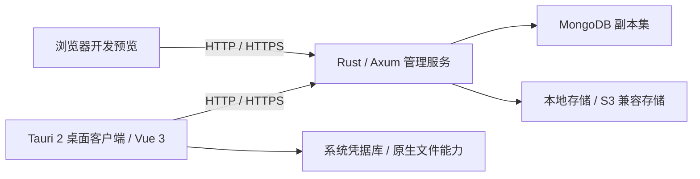

# TRI ADMIN

Tri Admin 是一套采用 **Tauri 2 + Vue 3 + Rust + MongoDB** 的管理后台工程，为游戏管理后台提供账号、权限、审计和文件等基础能力。

客户端、管理服务和数据库独立运行：桌面客户端通过 HTTP/HTTPS 连接 Rust 服务，由服务端统一处理认证、授权和数据访问。界面采用清新、优雅的青花蓝白风格，支持浏览器开发预览。

## 功能

当前版本聚焦以下七个模块：

| 模块     | 已实现能力                                                                 |
| -------- | -------------------------------------------------------------------------- |
| 工作台   | 用户、角色、菜单及权限数量概览，快捷入口，当前会话与连接状态               |
| 用户管理 | 用户创建、编辑、角色分配、启用/停用及密码重置                              |
| 角色管理 | 操作权限分配，全部、自身及指定角色的数据范围，受保护的系统管理员角色       |
| 菜单管理 | 导航层级、排序、启用状态及已注册页面入口管理                               |
| 权限目录 | 当前操作权限与实际 API 接口目录，按名称、操作码、路径或 HTTP 方法筛选      |
| 日志中心 | 登录、操作、错误日志，时间与结果等条件筛选，请求关联号、详情及受控历史清理 |
| 文件管理 | 文件分类、分片上传、断点续传、异步发布、完整性校验、文件资料维护及授权下载 |

服务端同时检查操作权限与数据范围；修改密码、禁用账号等操作会撤销相关会话。文件发布返回 `202` 时表示仍在处理，只有上传状态为 `completed` 才表示发布成功。

当前范围以 [产品规范](docs/product-spec.md) 和 [七模块设计](docs/superpowers/specs/2026-10-28-game-focused-scope-design.md) 为准。`docs/` 中保留的历史方案不代表当前版本均已提供。

## 技术方案

| 层次       | 技术                                  | 用途                                             |
| ---------- | ------------------------------------- | ------------------------------------------------ |
| 界面       | Vue 3、TypeScript、Element Plus       | 页面、表格、表单与统一主题                       |
| 状态与路由 | Pinia、Vue Router                     | 会话状态、菜单和页面导航                         |
| 前端构建   | Vite、npm workspaces                  | 开发预览、按页面加载与生产打包                   |
| 桌面客户端 | Tauri 2、Rust                         | 原生窗口、系统凭据库、文件对话框和原生文件处理   |
| 管理服务   | Rust 1.94、Axum、Tokio、Serde         | 异步 HTTP API、输入校验和后台文件任务            |
| 数据库     | MongoDB、官方 Rust 驱动               | 业务数据、会话、审计、索引及事务                 |
| 认证授权   | JWT、刷新会话轮换、Argon2、RBAC       | 管理员认证、密码散列、操作权限与数据范围         |
| 文件存储   | 受控本地目录、S3 兼容存储、SHA-256    | 分片与发布恢复、内容校验、授权下载               |
| 验证       | Rust 测试、Vitest、Playwright、Docker | 单元测试、真实 HTTP/MongoDB 集成测试和浏览器回归 |



MongoDB 需要支持事务的副本集。所有数据库凭据和文件存储凭据由服务端管理，客户端只保存管理服务地址；桌面端可使用系统凭据库保持登录，浏览器预览不持久保存刷新凭据。

## 开源协议

本项目采用 [MIT License](LICENSE)，允许商业使用、修改和再分发，使用时需保留版权声明和许可文本。第三方依赖遵循各自的许可证。

## 快速开始

### 环境要求

- Node.js 22+、npm。
- Rust 工具链由 `rust-toolchain.toml` 固定为 `1.94.0`。
- Docker Desktop / Docker Compose，或自行准备可访问的 MongoDB 副本集。
- Windows 原生桌面开发需要 MSVC 构建工具和 WebView2；仅进行浏览器预览时不需要启动 Tauri。

### 1. 获取源码并安装依赖

```powershell
git clone https://github.com/gmbytes/tri-admin.git
cd tri-admin
npm ci
```

### 2. 初始化并启动管理服务

```powershell
npm run dev:env
docker compose -f deploy/compose.dev.yaml up -d --wait
cargo run -p admin-api -- migrate
cargo run -p admin-api -- bootstrap
cargo run -p admin-api -- serve
```

`dev:env` 随机生成本地 `.env` 与独立密钥，已有文件不会覆盖，密钥不会打印。配置项示例见 [deploy/.env.example](deploy/.env.example)。已有环境缺少文件存储加密密钥时，可运行 `npm run dev:settings-key` 补充。

`bootstrap` 会在终端隐藏输入管理员密码，密码至少 12 个字符。默认账号为 **`admin`**，密码由你首次初始化时设置，没有通用默认密码；重复初始化不会重置已有密码。

升级服务端后应先执行 `migrate`，再运行 `serve`。`serve` 不自动迁移数据库；未满足模型和初始化要求时，就绪检查会返回未就绪。

### 3. 启动界面

保持管理服务运行，在另一个终端选择一种方式。

浏览器开发预览：

```powershell
npm run dev:desktop
```

Tauri 桌面客户端：

```powershell
npm run desktop
```

### 开发环境地址

| 服务         | 默认地址                                 |
| ------------ | ---------------------------------------- |
| 界面         | `http://127.0.0.1:1420/`                 |
| 管理 API     | `http://127.0.0.1:18088/api/v1`          |
| 存活检查     | `http://127.0.0.1:18088/health/live`     |
| 就绪检查     | `http://127.0.0.1:18088/health/ready`    |
| 开发 MongoDB | `127.0.0.1:13317`，副本集 `tri-admin-rs` |

默认允许 `localhost:1420` 和 `127.0.0.1:1420` 两个明确的开发来源。部署时使用 `TRI_CORS_ORIGINS` 显式配置来源。

## 构建与部署

```powershell
# 前端类型检查及生产构建
npm --workspace @tri-admin/desktop run build

# Rust 管理服务
cargo build -p admin-api --release

# Tauri 桌面安装包（当前配置为 Windows NSIS）
npm run build:desktop
```

默认输出位置分别为 `apps/desktop/dist/`、`target/release/` 和 `apps/desktop/src-tauri/target/release/bundle/`，均不进入版本控制。

发布时分别部署 Rust 服务和 MongoDB 副本集，在桌面客户端的“服务器设置”中填写 HTTPS 服务地址。开发 Compose 使用仅绑定本机的无认证测试数据库；生产数据库需要独立配置认证、网络访问和 TLS。真实环境配置与密钥不应写入仓库。

文件默认保存在服务端 `data/storage/`，可通过 `TRI_STORAGE_ROOT` 指定受控目录。S3 兼容驱动作为文件内部存储能力保留，界面仅提供必要的存储选项，不返回存储凭据。

## 工程结构

```text
tri-admin/
├─ apps/desktop/          Vue 界面与 Tauri 桌面工程
│  ├─ src/               页面、会话、API 客户端及文件处理
│  └─ src-tauri/         原生命令、系统凭据与桌面打包配置
├─ services/admin-api/   Rust 管理服务、数据库模型和集成测试
├─ crates/desktop-core/  桌面端共享逻辑
├─ deploy/               MongoDB 开发环境和配置模板
├─ tests/e2e/            浏览器端到端测试
├─ tools/                开发环境初始化及专项验证脚本
└─ docs/                 产品规范、设计和历史方案
```

## 验证

```powershell
cargo test --workspace -- --test-threads=2
cargo fmt --all -- --check
cargo clippy --workspace --all-targets -- -D warnings
npm test
npm run test:e2e
npm --workspace @tri-admin/desktop run build
```

对象存储独立验收使用 `npm run test:s3`，会创建带所有权标签的隔离 Docker 服务和随机测试凭据，完成真实文件读写、条件创建和发布验证后清理。默认测试中的外部专项单独记录，不计作已运行。

集成测试与浏览器测试需要本机 MongoDB 副本集；测试脚本使用独立测试数据库。Tauri 原生工程是独立 Cargo 工作区，需在具备桌面构建环境时另行验证。

## 版本控制约定

以根目录 [.gitignore](.gitignore) 为准。新机器应能通过仓库中的源码、锁文件和配置模板还原开发环境，本机凭据与运行数据单独保存。

| 内容                                                                                          | 是否进入版本 | 说明                                                                                   |
| --------------------------------------------------------------------------------------------- | ------------ | -------------------------------------------------------------------------------------- |
| `apps/desktop/src/`、`services/`、`crates/`                                                   | 必须         | 前端、Rust 服务与共享库源码                                                            |
| `tests/`、各项目的 `tests/`、`tools/`                                                         | 必须         | 测试、固定测试素材及开发/验收脚本；生成的测试数据除外                                  |
| `Cargo.toml`、两份 `Cargo.lock`、`package.json`、`package-lock.json`、`rust-toolchain.toml`   | 必须         | 应用依赖声明、依赖锁定和工具链版本                                                     |
| `vite.config.ts`、`tsconfig.json`、`playwright.config.ts`、格式化配置                         | 必须         | 可复现的构建、类型检查和测试约定                                                       |
| Tauri 的 `src/`、`build.rs`、`tauri.conf.json`、`capabilities/`、`icons/`，以及前端 `public/` | 必须         | 桌面程序配置、权限声明、品牌资源与打包图标                                             |
| `apps/desktop/src/components.d.ts`                                                            | 保留         | 虽由组件插件生成，但当前构建先执行 `vue-tsc`，首次构建需要这份全局组件类型声明         |
| `deploy/compose.dev.yaml`、`deploy/.env.example`、其他 `.env.*.example` / `.env.*.template`   | 必须         | 部署定义和不含真实凭据的配置模板                                                       |
| `README.md`、`docs/`、`.gitignore`、`.gitattributes`                                          | 必须         | 项目说明、设计与维护记录、版本控制规则                                                 |
| `node_modules/`、`target/`、`dist/`、Vite 缓存、`src-tauri/gen/`                              | 忽略         | 可重新安装或生成的依赖、构建结果、安装包和 schema                                      |
| `.env`、`.env.local`、`.env.production` 等、私钥、签名凭据、`secrets/`                        | 忽略         | 真实连接信息、口令、令牌与密钥；公开证书或固定测试证书需要入库时，应按精确路径单独放行 |
| `data/`、`backups/`、`dumps/`、日志、`artifacts/`、临时目录                                   | 忽略         | 上传文件、运行数据、数据库备份及本机产物；Docker 数据卷也不属于源码仓库                |
| `test-results/`、`playwright-report/`、`coverage/`、`.superpowers/`                           | 忽略         | 测试报告、截图、进程信息、自动化记录及本机开发凭据                                     |
| `.idea/`、`.vscode/`、`.vs/`、系统文件与编辑器备份                                            | 忽略         | 当前视为个人工作区设置；需要团队共享的配置再按文件精确放行                             |

不要笼统忽略所有图片、JSON、TOML、锁文件或整个 `docs/`，其中包含程序构建和维护所需的文件。忽略规则不会自动取消已经跟踪的文件；可运行 `git ls-files -ci --exclude-standard` 检查这类情况，再按具体文件处理。
