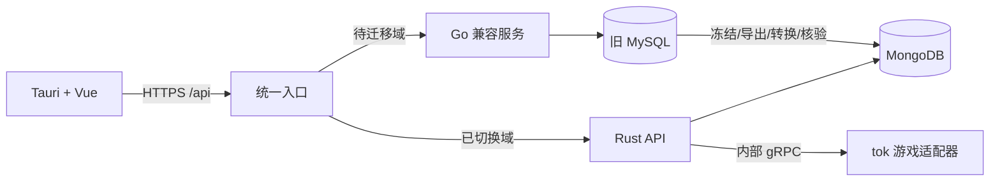

# tri-admin Tauri / Rust / MongoDB / tok Implementation Plan

> **For agentic workers:** REQUIRED SUB-SKILL: Use superpowers:executing-plans task-by-task. Use delegated execution only when chosen by the user. Track tests, rulings and commits in the execution ledger.

**Goal:** 在 tri-admin 实现 Tauri 客户端、远程 Rust/MongoDB 后台，逐步替换 vue-admin 的 Go 接口，并对接未来 tok 游戏服。

**Architecture:** Tauri + Vue 通过 HTTPS 请求统一入口；已迁移业务域由 Rust/MongoDB 负责，待迁移业务域暂由 Go/MySQL 负责。业务域冻结旧写入、导出转换、验证后整体切换；两个后端不同时拥有同一业务域的写入权。

**Tech Stack:** Tauri 2、Vue 3、Vite、Axum、Tokio、MongoDB 官方 Rust 驱动、BSON、bcrypt/JWT、Protobuf/Tonic。

**Spec:** 本文件“已确认需求与约束”是当前规范。

**版本:** V2，2026-10-24。用户在实施中选择“tri-admin 后台也改为 MongoDB”。本文件替代 V1 的 MySQL 运行时、SQLx、共库逐接口切换和 DDL 迁移要求。V1 已归档，仅用于历史追溯。

## 已确认需求与约束

- 新项目位于 `E:\hygd\work\backend\tri-admin`，来源 `vue-admin` 保持原样。
- Tauri + 远程 Rust 服务；Go 接口逐步迁移，最终统一 Rust 服务端技术栈。
- 新后台统一使用 MongoDB；未来游戏服框架为 `mogud/tok`。
- 保留 Vue 页面、HTTP 路径、响应语义、字段大小写、旧账号密码摘要和业务数据。
- 首发 Windows x64 客户端与 Linux x64 服务；客户端不包含服务进程或数据库，也不保存数据库密码。
- 游戏服和后台独立部署，通过版本化管理协议通信；后台不直接修改在线玩家存档。
- 不重建现有库、不覆盖已有管理员密码、不提交真实账号资料、密钥或生产数据。
- UI 全量重设计、完整游戏玩法/场景/战斗和游戏客户端不属于当前迁移项目。

## 现状与决定

- 来源最初提交 `5f3683b`，另有用户工作区修改；实际来源提交和差异写入基线记录。
- 已采集实际 Gin Router：210 个方法/路径组合；Swagger 127 个操作；合并候选 232 个，22 个未实际注册。
- 独立 MySQL 测试库已导出 36 张空表、334 个字段、84 个索引字段；仅作为来源/导入证据。
- MySQL 专用 Rust bootstrap 测试按新方向替换为 MongoDB 测试；原 SQL 基线移入 `contracts/schema/`，不是新后台运行时迁移。
- MongoDB 官方驱动核对到 3.9.1，MSRV 1.88；后台锁定本机已有 Rust 1.94.0。
- 开发使用本机已有 MongoDB 8.2.1 镜像的固定 digest，单独建立本机 13317 端口副本集，不修改既有 27017 实例。
- 事务相关测试使用真实副本集；生产部署需认证/TLS。后台、游戏工程分构建边界，tok 的 Rust 1.99.0 要求独立验证。

## Global Constraints

1. 新后台运行时仅使用 MongoDB，MySQL 只属于旧兼容系统与导入工具。
2. 保留方法/路径清单，但切换以关联业务域为单位；写请求不双发，不在超时后自动投回旧后端。
3. 用户、角色、菜单、按钮和权限作为一个一致性域；不允许新旧系统独立更新账号和权限。
4. MongoDB `_id` 为内部标识；外部旧数值 ID 使用独立 `id` 字段和原子计数器，导入后计数器推进至最大旧 ID。
5. 游戏玩家/区服 ID 在线路中使用字符串，与后台管理员 ID 分离。
6. 保留 `code=0/7`、HTTP 状态、`ID/CreatedAt/UpdatedAt`、分页以及 JWT 自定义字段大小写；DTO 不暴露 BSON Extended JSON。
7. MongoDB 使用唯一/复合/部分索引、版本化文档迁移和输入验证。多集合关系变更通过事务完成。
8. 数据先导入独立目标库并核验；生产写请求不用于影子回放。真实结果和合成夹具分开报告。
9. 已有 MongoDB 新写入时，回退前先冻结写入、反向转换并核验，不能直接切回过期 MySQL。
10. 未迁移扩展保留明确状态；所有实际接口、后台任务和功能均处理完毕后才能移除 Go。

## MongoDB 文档模型

| 集合 | 模型与索引 |
| --- | --- |
| `sys_users` | id、UUID、用户名、bcrypt、资料、当前角色、authority_ids；活动用户名唯一 |
| `sys_authorities` | authority_id、角色名、menu_ids、按钮和数据权限；authority_id 唯一 |
| `sys_base_menus` | 旧菜单 ID、父级、路由、组件、排序、元数据 |
| `casbin_rule` | 角色/path/method 策略与唯一复合索引，保持原 matcher |
| 字典、参数、日志和版本集合 | 按真实过滤/排序建索引，日志不嵌入无界数组 |
| 文件、模板、Token、开放应用集合 | 元数据和摘要存 MongoDB，文件内容继续走文件/对象存储 |
| `_counters` / `_schema_migrations` | 原子数值序列、版本和校验摘要 |
| `game_admin_jobs` | 唯一 request_id、负载摘要、状态、区服、审计与实际结果 |

旧关联表转换为有界 ID 数组；无界数据独立集合。软删除使用 BSON 日期/null；接口时间由 DTO 显式转换。导入检查重复用户名、缺失关联、ID 溢出及最大值，禁止静默丢弃。

## Review Focus

- JWT 刷新/撤销/禁用在切换后保持一致；旧独立认证写入口必须关闭（Task 5–6）。
- 并发初始化、事务中断和索引冲突不得产生重复管理员或残缺权限（Task 2、6）。
- ID、NULL、时间、软删除和关联表转换需要真实导入测试（Task 1、5、7）。
- 安装包网络、CORS、上传下载、断网和令牌过期须实际验证（Task 4、8、12）。
- tok 命令超时/重启/重复提交必须可核查，发布接受不等于执行完成（Task 10–11）。

## 文件结构与接口

`apps/desktop/` 承载 Vue 与 `src-tauri/`；`services/admin-api/` 承载远程服务；业务模块位于其 `src/modules/<domain>/{dto,router,service,repository}.rs`。`crates/game-admin-{protocol,client}/` 为管理协议和客户端；`legacy/go/` 为脱敏兼容副本；`contracts/` 为路由/数据/夹具；`tools/` 为迁移工具；`deploy/` 为环境；`tests/{e2e,native,gateway}/` 为不同验证边界。

网关只剥离一次 `/api`。生产统一 HTTPS；开发建议 Go 8088、Rust 18088、网关 8089、Vite 1420、MongoDB 13317。旧模块通过兼容层使用新身份/权限；无法满足一致性边界的关联模块一同迁移。

## Task 1：来源与数据契约基线

**Files:** `contracts/{routes.json,runtime-routes.json,compatibility.md,fixtures/,schema/,mongo-mapping.json}`；`tools/{inventory,compare-contracts}.mjs`、Go 捕获工具和 `tools/tests/`；`docs/source-baseline.md`。

**Interfaces:** `inventory({sourceRoot,runtimeRoutes,swaggerPath}) -> RouteRecord[]`；`compareContract(expected,actual,normalizers) -> Difference[]`；记录 method/path/auth/module/owner/status/evidence。

- [ ] 先测试重复路由、方法区分、Swagger 漏项、注释、字段类型、null、数组顺序、敏感数据保存拒绝。
- [ ] 实现四路清单、差异比对和来源版本/工作区记录。
- [ ] 采集脱敏真实 HTTP 与空表结构，建立字段、关联表、索引和序列到 MongoDB 的完整映射。
- [ ] 用独立数据库验证映射覆盖与实际夹具，合成数据不冒充 HTTP 捕获。
- [ ] `npm test`、清单 `--check`、契约自比较通过并记录证据。

## Task 2：Rust/MongoDB 基础和幂等初始化

**Files:** `services/admin-api/src/{lib,main,config,state,bootstrap}.rs`、`common/{error,response}.rs`、`modules/health.rs`、`storage/{schema,indexes}.rs`；`tests/{health,response,bootstrap}_contract.rs`；开发环境与生成工具。

**Interfaces:** `build_router(AppState)->Router`；`AppState` 持有配置、可选 Database、共享服务；`ApiResponse<T>{code,data,msg}`；`bootstrap_database(&Database,&AdminInput)->Result<BootstrapReport,AppError>`。

- [ ] 先测试旧响应、401/code=7、DB 缺失 ready=503、Debug 脱敏、重复/并发初始化不覆盖密码。
- [ ] 建立官方驱动与独立副本集，运行测试观察缺失功能失败。
- [ ] 实现配置、健康/就绪、日志、索引、文档版本与事务初始化；已有用户保持原样。
- [ ] 提供服务端 migrate/bootstrap CLI，密码交互输入；测试事务中断、索引和版本冲突。
- [ ] 真实 MongoDB 集成、格式、lint 全部通过后提交。

## Task 3：统一入口与业务域所有权

**Files:** `legacy/go/`、`contracts/route-owners.json`、`tools/render-gateway.mjs`、`deploy/nginx/`、网关测试、迁移手册。

**Interfaces:** RouteOwner 包含 method/path/domain/upstream；`renderGateway(RouteOwner[])->string`，同域写路由只有一个所有者。

- [ ] 先测试方法、query、前缀、流式转发、超时不双发、同域写入不允许部分切换。
- [ ] 建立脱敏 Go 副本，仍连接独立旧 MySQL；不做虚假的 MongoDB Gorm 适配。
- [ ] 实现生成器、统一入口与精确所有权清单。
- [ ] 定义 freeze/export/import/verify/switch 状态与失败恢复门禁。
- [ ] 真实上游 smoke 和回退条件测试通过后提交。

## Task 4：Tauri 客户端

**Files:** `apps/desktop/`、`src-tauri/`、`src/platform/{endpoint,session,files}.ts`、统一请求与端到端测试。

**Interfaces:** `resolveApiBase(EndpointSettings)->URL`，只含一次 `/api`；Vue 继续使用旧 DTO。

- [ ] 先测试 URL、HTTP/业务错误区分、断网、过期和设置持久化。
- [ ] 复用 Vue/Pinia，建立 Tauri/Vite 和远程服务设置，限定实际本机能力及 API 域名。
- [ ] 完成注销、上传下载、CORS 与 CSP，客户端不含 DB 凭据。
- [ ] Vitest、Playwright、WebdriverIO/tauri-driver 分别覆盖逻辑、页面和原生窗口。
- [ ] Windows 安装包实际验证登录/菜单/列表/退出/重启/断网。

## Task 5：导入工具与认证迁移

**Files:** `tools/import/`、`contracts/mongo-mapping.json`、`src/modules/auth/`、`tests/{import,auth}_compatibility.rs`。

**Interfaces:** 数据包包含来源/模型版本、计数、摘要与各域内容；`AuthContext{user_id,authority_id,username,session_id}`，外部 JWT 字段按旧契约。

- [ ] 先测试 ID/关联转换、重复/缺失引用、序列推进、bcrypt 摘要、错误密码、过期/撤销/禁用。
- [ ] 导出只读包，离线验证后导入独立目标库；不重新哈希旧密码摘要。
- [ ] 实现验证码、限流、会话和日志；冻结旧账号写入后导入最终状态并关闭旧独立登录入口。
- [ ] 为旧业务提供受控新会话/权限验证与必要只读镜像；不产生第二套账号写入权。
- [ ] 完成认证真实测试、导入/回退演练和桌面 smoke 后整体切换认证域。

## Task 6：用户、角色、菜单和权限

**Files:** `src/modules/{users,roles,menus,permissions}/`、RBAC 和用户菜单契约测试。

**Interfaces:** `authorize(&AuthContext,method,path)`，matcher 保留 sub/path keyMatch2/method 语义；菜单 DTO 不改字段。

- [ ] 先测试受限角色、按钮/菜单/数据权限、参数路径、软删除、禁用与权限变更。
- [ ] 用有界数组和独立策略替代关联表查询，关系更新放入事务。
- [ ] 实现统一策略版本和缓存失效，兼容入口不使用独立旧权限。
- [ ] 管理员和至少两个受限角色完成真实流程及越权检查。
- [ ] 关联写接口整体切换，数据与契约通过后提交。

## Task 7：常规管理模块

**Files:** `src/modules/{dictionaries,params,api_catalog,login_logs,operation_logs,errors,versions,customers}/` 与各模块测试。

- [ ] 每个模块先测试成功、空值、权限、分页、软删除与并发更新。
- [ ] 实现 DTO/路由/服务/MongoDB 仓储，过滤/排序字段白名单化并按查询建索引。
- [ ] 与旧系统脱敏数据比较计数、顺序、时间和审计，避免无界数组与不稳定分页。
- [ ] 域冻结、最终导入和反向数据转换验证后切换。
- [ ] 每个模块测试与页面 smoke 通过即提交，直到清单完成。

## Task 8：文件、导出、Token 和开放应用

**Files:** `src/modules/{attachments,exports,api_tokens,open_apps}/`、契约测试与客户端文件适配。

- [ ] 先测试分片、取消、重名、路径、导出字段、Token 过期/撤销、跨应用 Scope 越权。
- [ ] 元数据存 MongoDB，文件仍走原文件/对象存储；按实际驱动清单逐项处理。
- [ ] SQL 模板转为受控 MongoDB 字段/过滤/关联配置；不能转换的定义明确报告，不执行任意输入表达式。
- [ ] 保留 SHA-256 Token 摘要和一次性明文签发；开放应用/玩家身份与管理员分开。
- [ ] 安装包文件、导入导出、权限及真实上游验证通过后按域切换。

## Task 9：扩展工具与移除 Go

**Files:** `docs/feature-parity.md`、`src/modules/{codegen,skills,mcp,system_settings}/`、生成工程与扩展测试。

- [ ] 按真实清单逐项记录来源、依赖、实现和验证，包含 Swagger 漏项。
- [ ] 测试先失败再实现配置、Skills/MCP、已启用 AI/Workflow 和任务取消。
- [ ] 新增 Rust/MongoDB 代码模板；旧 Go/SQL 模板作为兼容目标分别构建验证。
- [ ] 外部协议夹具和真实结果分别记录，安装目录与进程/网络权限受控。
- [ ] 所有范围内功能和后台任务归 Rust 后停 Go 演练，旧库只读封存，不自动删除。

## Task 10：tok 固定版本与管理协议

**Files:** `contracts/game-admin/v1/admin.proto`、`crates/game-admin-{protocol,client}/`、集成说明和独立游戏验证工程。

固定 tok 提交 `4842fd69649fc767aef74d42daa4c280b668e278`；其 Rust 1.99.0 工具链独立核验。

- [ ] 验证工具链可获取与固定版本可复现；失败记录兼容报告，不默默降版本。
- [ ] 测试 GetCapabilities/GetServerStatus/QueryPlayers/SubmitCommand/GetCommandStatus 的版本、区服、deadline、取消和不可用。
- [ ] 先 fake 联通，再在真实 tok 游戏应用绑定自定义 protobuf 管理端点。
- [ ] 只使用公开入口验证身份与只读查询，不绑定框架内部类型。
- [ ] 分别记录 Windows/Linux 实际结果；上游未完成的生产安全、存储等能力不作为现成功能依赖。

## Task 11：可靠游戏管理命令

**Files:** `src/modules/game_admin/`、命令测试、桌面管理页与游戏端执行记录。

**Interfaces:** request_id 唯一；状态 pending/running/succeeded/failed/unknown；同键同负载返回原结果，不同负载冲突。

- [ ] 先测试重复、超时、重启、部分完成、越权和同键不同参数。
- [ ] MongoDB 事务持久化任务/审计/摘要，提交后 worker 发送；游戏端提供业务幂等与查询。
- [ ] 未知结果保持 unknown 并核对；业务确认后才 succeeded，NATS 接受发布不算完成。
- [ ] 先只读区服/玩家，再按实际能力实现踢人/封禁/公告；发奖扣费另定规则。
- [ ] 服务认证、TLS/私网、停止传播和故障恢复验证后开放对应操作。

## Task 12：发布与最终审计

**Files:** 服务镜像、生产 MongoDB 副本集示例、安装包、CI、部署/升级/回退/运维说明及 smoke。

- [ ] 实测新装、升级、旧客户端兼容、断网、DB/游戏服离线和普通后台可用性。
- [ ] 演练 MongoDB 备份恢复、文档迁移、域冻结和反向转换，有新写入时不直接切旧库。
- [ ] 全套 Rust/Node/前端/契约/网关、格式和 lint；Windows 实测客户端，Linux 实测服务。
- [ ] 同硬件/数据/并发比较性能基线，不预先承诺倍数。
- [ ] 每项交付都有当前证据，Go 调用和任务依赖归零后移除生产旧上游。

## 执行与完成定义

1→2→3→4 建立基础及桌面入口；5→6 完成认证权限域；7→8→9 完成其余功能；10 在认证域后独立验证，11 依赖真实 tok 协议，最后 12。

最终需证明全部来源功能和接口已处理、旧账号数据保持可用、Rust 后台运行不依赖 Go/MySQL、MongoDB 事务/导入/恢复实测、Windows 客户端和 Linux 服务实测、tok 真实接入及命令幂等有结果。骨架和少量通过测试不等于完整目标完成。

## 来源

- `E:\hygd\work\backend\vue-admin` 的实际代码、Router 和空表结构。
- [MongoDB Rust 驱动](https://www.mongodb.com/docs/drivers/rust/current/)、[事务](https://www.mongodb.com/docs/drivers/rust/current/crud/transactions/)。
- [Tauri](https://v2.tauri.app/)、[Axum](https://docs.rs/axum/latest/axum/)。
- [tok 固定提交](https://github.com/mogud/tok/tree/4842fd69649fc767aef74d42daa4c280b668e278)。
