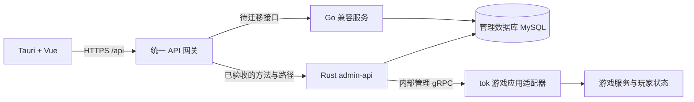

# tri-admin：Tauri + 远程 Rust 服务 + tok 游戏服接入 Implementation Plan

> **For agentic workers:** REQUIRED SUB-SKILL: Use superpowers:executing-plans to implement this plan task-by-task. Use superpowers:subagent-driven-development only if the user chooses delegated execution. Steps use checkbox (`- [ ]`) syntax for tracking.

**Goal:** 在 `E:\hygd\work\backend\tri-admin` 建立独立的桌面管理系统，将 `vue-admin` 的 Go 接口分批迁移为远程 Rust 服务，并为未来基于 `mogud/tok` 的游戏服提供管理接入边界。

**Architecture:** Tauri 2 承载 Vue 3 管理界面，通过 HTTPS 访问统一 API 入口。迁移期由网关按照 HTTP 方法和路径将请求交给 Go 或 Rust，每个接口始终只有一个写入实现；最终移除 Go 上游。游戏服使用 tok，Rust 管理服务通过独立的内部管理协议与之通信。

**Tech Stack:** Tauri 2、Vue 3、Vite、Element Plus、Pinia；Rust、Axum、Tokio、SQLx、MySQL；迁移网关采用 Nginx；游戏管理协议采用 Protobuf/Tonic gRPC。具体依赖版本在环境验证后锁定并提交 lockfile。

**Spec:** 本文件“需求与设计约束”记录用户已确定的方向和本计划提出的默认方案；不需要依赖其他设计文档阅读。

**日期 / 状态:** 2026-10-24 / 规划稿；本文件不代表实现或部署已完成。

## 需求与设计约束

### 用户已确定

- 新项目目录：`E:\hygd\work\backend\tri-admin`。
- 迁移来源：`E:\hygd\work\backend\vue-admin`。
- 架构：**Tauri + 远程 Rust 服务**。
- 迁移方式：**将现有 Go 接口逐步迁移到 Rust**。
- 长期目标：**统一为 Rust 技术栈**；Vue 继续承担界面开发。
- 未来游戏服务器框架：<https://github.com/mogud/tok>。

### 本计划提出的默认方案

- 首个客户端交付目标为 Windows x64；服务端交付目标为 Linux x64 容器。
- 首轮保持现有 Vue 页面、菜单、接口路径、JSON 字段和 MySQL 数据结构，降低前后端同时变化带来的风险。
- 管理后台保留 MySQL；游戏服的数据持久化由游戏项目决定，不由后台迁移强制指定。
- 桌面客户端只连接服务端，不打包 Go/Rust 后台服务，不保存数据库连接密码，不要求终端用户安装 MySQL。
- 管理后台数据库与游戏业务数据按权限和所有者分开管理；后台通过游戏管理协议操作在线玩家状态。
- 当前先迁移管理后台；完整游戏玩法、战斗、场景、游戏存储层和游戏客户端开发另立项目计划。
- 首版不进行 UI 全量重设计，也不同时切换 PostgreSQL、重做所有代码生成模板或引入 Kubernetes。

### 已检查的现状

- `tri-admin` 目前为空目录。
- `vue-admin` 使用 Vue 3 + Vite、Gin + Gorm + Casbin；前端有 26 个 API 文件。
- `server/docs/swagger.json` 记录 123 个路径、127 个操作；这是文档基线，不能当作全部运行时接口。
- 已有用户、角色、菜单、按钮、字典、参数、日志、API Token、开放应用、文件、导出模板、代码生成、Skills/MCP 等模块。
- 登录密码采用 bcrypt；管理端 JWT 使用 HS256，包含现有大小写字段；API Token 采用 SHA-256 摘要存储。
- Casbin 当前 matcher 为 `r.sub == p.sub && keyMatch2(r.obj,p.obj) && r.act == p.act`，不能未经验证改成另一套角色继承语义。
- 普通业务响应为 `{code,data,msg}`，成功 `code=0`，业务失败常为 HTTP 200 + `code=7`；未认证可为 HTTP 401。
- 公共字段存在 `ID`、`CreatedAt`、`UpdatedAt`，不能全量改为小写或 camelCase。
- 来源仓库当前可见提交为 `5f3683b`，另有用户工作区修改；执行时须记录实际来源提交及差异，不覆盖来源目录。

### tok 核对记录与接入边界

核对提交：`4842fd69649fc767aef74d42daa4c280b668e278`；后续执行以此提交复现，升级另做验证。

- README 将 tok 描述为实验性的 Rust 游戏服务器框架，目标为 Windows amd64 / Linux amd64。
- 已描述的能力包含 Tonic/gRPC、服务生命周期、Memory/Redis 发现与所有权、请求锁、TCP session、timer、ACK/恢复及 Core NATS 即时事件。
- 仓库固定 `rust-toolchain.toml` 为 `1.99.0`，workspace `rust-version=1.99`；本机检查到 `rustc/cargo 1.94.1`，本次未构建 tok。
- README/status 明确将生产安全、Kubernetes、JetStream、Redis Cluster、Scene、离线加载和存储等列为未完成或后续范围；不能把设计目标当成已经具备的能力。
- Core NATS 发布成功只表示客户端接受发布，不表示远端业务完成；可靠管理命令必须有业务确认、持久状态与幂等键。
- tok 的内部执行上下文、deadline 和取消契约需要通过适配器保留；管理协议属于游戏应用扩展，不宣称 tok 已内置 GM 接口。
- 后台和 tok 分进程、分构建边界。后台依赖稳定的管理协议，而非直接依赖 tok 内部 Rust 类型；工具链不匹配先在独立验证工程处理。

## Global Constraints

- Tauri + 远程 Rust 服务。
- 将现有 Go 接口逐步迁移到 Rust。
- 长期统一为 Rust 技术栈。
- 未来游戏服务器使用 `mogud/tok`。
- 来源工程保持可运行；迁移改动在新工程或独立的兼容副本完成。
- 生产请求按方法和路径只进入一个实现；写请求不双发、不在超时后自动改投另一实现。
- 生产数据库结构由版本化迁移管理；Go AutoMigrate 与 Rust DDL 不能并发拥有迁移权。
- 复用已有密码摘要和账号数据；不得通过覆盖管理员密码或重建数据库完成迁移。
- 不提交真实账号信息、JWT 密钥、数据库密码、上传文件、生产日志或数据库备份。
- 远程服务端完成初始化和建表；普通桌面使用者只设置/选择服务地址并登录。

## Review Focus

1. Go 与 Rust 的 JWT 字段、刷新、禁用用户、退出和撤销行为必须互通；过期或撤销令牌不可被另一实现重新接受（Task 5）。
2. 路由切换、并发写入和失败重试不得重复创建、丢失更新或让 Go/Rust 同时修改 schema（Task 3、7）。
3. 旧库的软删除、NULL、时间、枚举和大整数 ID 必须维持原有数据含义（Task 1、7）。
4. Tauri 安装包中的上传、下载、HTTPS、断网和会话过期行为必须与开发窗口一致（Task 4、8、12）。
5. tok 管理命令在超时、重复请求、进程重启或部分完成时必须能查询实际状态，不能通过盲目重试重复发放或执行（Task 10、11）。

## 目标结构与职责

```text
tri-admin/
├─ Cargo.toml                         # 后台与公共协议相关 Rust workspace
├─ apps/desktop/                      # 迁移后的 Vue 应用
│  ├─ src/                           # 页面、Pinia、API、桌面环境适配
│  └─ src-tauri/                     # 窗口、受控文件操作、客户端打包
├─ services/admin-api/                # 远程 Rust HTTP 服务
│  ├─ src/common/                    # 配置、响应、错误、认证上下文
│  ├─ src/modules/                   # 每个业务模块包含 DTO/路由/服务/仓储
│  ├─ migrations/                    # 兼容旧 MySQL schema 的版本化迁移
│  └─ tests/                         # 集成及兼容测试
├─ crates/game-admin-protocol/        # 自有管理协议的生成 Rust 类型
├─ crates/game-admin-client/          # 后台到游戏管理端点的客户端
├─ legacy/go/                        # 脱敏后的 Go 服务兼容副本
├─ contracts/                        # 接口清单、脱敏请求/响应、迁移所有权
├─ tools/                            # 清单生成、契约比对、网关配置生成
├─ tests/e2e/                        # 页面与安装包端到端流程
├─ deploy/                           # 网关、容器、示例配置和部署手册
└─ docs/                             # 计划、兼容报告和运维说明
```

tok 框架和游戏应用保留在游戏工程；`tri-admin` 不复制一份框架源码。未来游戏工程实现本计划定义的管理协议，框架版本仅影响游戏适配器。

下文的文件位置均相对于 `tri-admin/`；业务模块使用 `services/admin-api/src/modules/`，不在 Tauri 本机进程中实现远程后台业务。根 `package.json` 管理前端测试与端到端工具；`apps/desktop/package.json` 管理 Vue/Tauri 的开发和构建。

## 访问与迁移拓扑



- 网关负责统一剥离一次 `/api`，上游继续使用现有路径；`/health` 等探针单独列出。
- 迁移清单以 `(HTTP method, normalized path)` 标识所有者，初始业务接口归 Go。
- Rust 返回业务错误或超时后不再自动回退 Go；回退由发布配置显式切换。
- 生产统一入口使用 HTTPS 443。建议本地开发：Go 保留 8088，Rust 18088，网关 8089，桌面 Vite 1420；这些是隔离建议，不修改现有来源配置。
- 不以旁路调用生产写接口做影子比对；写接口使用独立测试库和脱敏夹具。

## 里程碑

| 里程碑 | 内容 | 交付 / 验收 |
| --- | --- | --- |
| M0 | 来源快照、接口和数据库基线 | 实际路由/API/Swagger 差异表、兼容夹具、逐接口迁移清单 |
| M1 | Rust 服务基础与迁移网关 | 健康/就绪检查、配置、测试库初始化、全部旧接口仍可经统一入口访问 |
| M2 | Tauri 客户端 | Windows 开发窗口和安装包可通过统一入口完成旧后台核心流程 |
| M3 | 账号与权限 | Rust 登录/JWT/用户/角色/菜单/按钮权限通过旧数据兼容测试 |
| M4 | 管理与工具模块 | 按模块切换字典、参数、日志、文件、导出、API Token、开放应用等 |
| M5 | 扩展模块与最终切换 | 代码生成/MCP/Skills 的迁移或明确处理结论；全部范围内路由归 Rust，Go 依赖归零 |
| M6 | tok 接入验证 | 固定版本构建报告、管理协议、最小查询链路、故障与幂等验证 |
| M7 | 正式交付 | Linux 服务镜像、Windows 安装包、迁移/回退演练和运维文档 |

M6 可在 M3 之后独立验证，不阻塞后台通用模块迁移；未通过 tok 版本/协议验证时，不开放游戏写操作。

## Task 1：建立可复现的迁移基线（M0）

**Files:** 创建 `contracts/routes.json`、`contracts/compatibility.md`、`contracts/fixtures/`、`tools/inventory.mjs`、`tools/compare-contracts.mjs`、`tools/tests/inventory.test.mjs`、`docs/source-baseline.md`。

**Interfaces:** `inventory({sourceRoot, runtimeRoutes, swaggerPath}) -> RouteRecord[]`；`RouteRecord={method,path,auth,module,owner,status,evidence}`；`compareContract(expected,actual,normalizers) -> Difference[]`。允许归一化的仅为声明过的随机值、时间和凭据，不能归一化业务错误、权限结果或数据类型。

- [ ] 写 `inventory.test.mjs`：断言重复方法/路径报错、Swagger 缺失路由仍进入清单、同路径不同方法独立记录、夹具包含密钥时拒绝保存。
- [ ] 运行 `node --test tools/tests/inventory.test.mjs`，确认测试先失败。
- [ ] 实现清单与对比工具，记录来源提交和工作区差异；从路由源码、实际 Router 路由、前端 API 和 Swagger 四路合并，标记未被 UI 使用的接口。
- [ ] 在独立测试库采集成功、参数错误、未认证、无权限、空列表、软删除、NULL、时区和大 ID 夹具；旧库结构从脱敏结构转储建立，真实数据不进入仓库。
- [ ] 重跑工具测试和契约自比较，要求零差异、所有接口都有所有者与验收状态；提交 `docs: 建立迁移契约基线`。

## Task 2：交付 Rust 服务基础与可控初始化（M1）

**Files:** 创建 `Cargo.toml`、`services/admin-api/Cargo.toml`、`src/{main,lib,config,state}.rs`、`src/common/{error,response}.rs`、`src/modules/health.rs`、`migrations/`、`tests/{bootstrap,health,response}_contract.rs`、`deploy/.env.example`、`deploy/compose.dev.yaml`。

**Interfaces:** `build_router(state: AppState) -> axum::Router`；`AppState` 提供 `MySqlPool`、配置和共享认证/权限能力；`ApiResponse<T>{code:i32,data:T,msg:String}`；`bootstrap_database(pool, admin_input) -> Result<BootstrapReport, AppError>`；已有账号不覆盖。

- [ ] 写测试：业务成功 JSON 保留 `code=0`；未认证为 401；缺少数据库时就绪检查返回 503；重复初始化不新增管理员、不更改密码。
- [ ] 执行 `cargo test -p admin-api --test health_contract --test response_contract --test bootstrap_contract`，确认测试先失败。
- [ ] 实现配置、连接池、结构化日志、错误映射、`/health` 和 `/ready`；增加服务端迁移/初始化 CLI，管理员密码通过交互或临时受控输入提供，不写入命令日志。
- [ ] 在空测试库和旧结构测试库分别执行迁移；基线迁移只在结构核验匹配后登记，遇到差异给出报告，不强行执行破坏性变更。
- [ ] 上述测试通过，执行 `cargo fmt --all -- --check`、`cargo clippy -p admin-api --all-targets -- -D warnings`；提交 `feat: 建立 Rust 后台基础`。

## Task 3：建立 Go/Rust 并行入口及回退机制（M1）

**Files:** 创建 `legacy/go/` 兼容副本、`contracts/route-owners.json`、`tools/render-gateway.mjs`、`tools/tests/gateway.test.mjs`、`deploy/nginx/`、`tests/gateway/route-smoke.mjs`、`docs/migration-runbook.md`。

**Interfaces:** `renderGateway(routes: RouteOwner[]) -> string`；`RouteOwner={method,path,upstream:'go'|'rust'}`，消费者为 Nginx 配置生成器。每个路由只有一个所有者，重复记录或未知上游导致配置生成失败。

- [ ] 写路由测试：GET 与 POST 可分配不同上游；带查询参数仍匹配正确路径；`/api` 只剥离一次；写请求超时后上游请求计数仍为 1。
- [ ] 运行 `node --test tools/tests/gateway.test.mjs`，确认测试先失败。
- [ ] 建立脱敏兼容副本，排除 `.git`、构建缓存、密钥、数据库和用户文件；关闭共享迁移环境中的 Go AutoMigrate，由 Rust 迁移工具唯一执行 DDL。
- [ ] 实现并生成网关配置，初始业务接口全部交给 Go；测试将一个只读接口转 Rust 后再显式转回 Go，不修改客户端地址。
- [ ] 在测试容器运行配置校验及 `node tests/gateway/route-smoke.mjs`，验证方法、请求体、上传流、响应头、状态码和回退；提交 `feat: 建立逐接口迁移入口`。

## Task 4：交付可连接统一入口的 Tauri 客户端（M2）

**Files:** 创建根 `package.json`、`apps/desktop/`（复用 Vue 源码）、`apps/desktop/src-tauri/{Cargo.toml,tauri.conf.json,capabilities/default.json,src/lib.rs}`、`apps/desktop/src/platform/{endpoint,session,files}.ts`、`apps/desktop/src/utils/request.js`、`tests/e2e/web-smoke.spec.ts`、`tests/native/{wdio.conf.ts,desktop-smoke.spec.ts}`。

**Interfaces:** `resolveApiBase(settings: EndpointSettings) -> URL`；`EndpointSettings={apiBaseUrl:string}`；API 基址统一包含 `/api`。生产地址为 HTTPS，开发环境显式允许本机 HTTP；现有 API 文件调用保持一致。

- [ ] 写端点与会话测试：末尾斜杠不会造成 `/api/api`；HTTP 错误与业务 `code=7` 分别提示；令牌过期回登录；客户端配置和日志不包含数据库密码。
- [ ] 运行 `npm --prefix apps/desktop test -- endpoint session`，确认测试先失败。
- [ ] 复用页面和 Pinia，加入 Tauri 构建配置、服务地址设置与统一请求入口；使用系统 WebView 的 HTTPS 请求，服务端配置实际 Tauri Origin 的 CORS 白名单，CSP 限定已批准的 API 域名。配置桌面包 `test` 为 Vitest、`build` 为 Vite、`tauri` 为 Tauri CLI；根包配置 `test:e2e` 为 Playwright、`test:native` 为 WebdriverIO + tauri-driver。
- [ ] 实现断网/超时提示、注销和下载适配；只为实际需要的窗口/文件能力授予权限，不给远程网页授予本机能力。
- [ ] 执行 `npm --prefix apps/desktop run build`、`npm run test:e2e` 和 `npm run test:native`；实际安装 Windows 包核对登录、菜单、列表、退出、重启、断网恢复。浏览器 Playwright 结果不能替代原生窗口与安装包验证；提交 `feat: 交付 Tauri 管理客户端`。

## Task 5：迁移认证与会话，验证跨实现互通（M3）

**Files:** 创建 `services/admin-api/src/modules/auth/{mod,router,dto,service,repository,jwt,captcha,revocation}.rs`、`tests/auth_compatibility.rs`、`contracts/fixtures/auth/`；按需修改 `legacy/go/` 中共享撤销状态的兼容层。

**Interfaces:** `authenticate(credentials: LoginInput, state: &AppState) -> Result<LoginOutput, AppError>`；`verify_access_token(raw: &str, state: &AppState) -> Result<AuthContext, AppError>`；`AuthContext={user_id:u64,authority_id:u64,username:String,session_id:Option<String>}`。外部 JWT 和响应字段严格以 Task 1 夹具为准，不直接序列化内部类型。

- [ ] 写测试：已有 bcrypt 摘要可登录；错误密码失败；数据库未初始化明确报告服务未就绪；禁用用户、过期 JWT、错误签名、退出后的令牌均拒绝。
- [ ] 执行 `cargo test -p admin-api --test auth_compatibility`，确认测试先失败。
- [ ] 实现旧字段/HS256 的明确兼容验证、验证码及限流、刷新响应头、登录日志；Go/Rust 使用一致的撤销记录和用户启用状态，必要兼容修改只放在新工程的 Go 副本。
- [ ] 生成 Go 签发/Rust 验证和 Rust 签发/Go 验证夹具；验证刷新、并发请求和两端注销；共享签名密钥仅通过部署密钥注入。
- [ ] 契约比对及认证测试全通过后，只切换认证相关路由；提交 `feat: 迁移认证与会话`。

## Task 6：迁移用户、角色、菜单与权限（M3）

**Files:** 创建 `services/admin-api/src/modules/{users,roles,menus,permissions}/` 各自的 `router.rs`、`dto.rs`、`service.rs`、`repository.rs`；创建 `services/admin-api/tests/rbac_compatibility.rs`、`services/admin-api/tests/user_menu_contract.rs`。

**Interfaces:** `authorize(ctx:&AuthContext, method:&str, path:&str) -> Result<(),AppError>`；`load_menu_tree(user_id:u64,authority_id:u64) -> Result<Vec<MenuNode>,AppError>`。匹配规则沿用来源 Casbin 模型；数据权限和菜单/按钮权限分别验证。

- [ ] 写测试：角色无权限时无法调用接口；隐藏按钮不代替服务端鉴权；切换角色后菜单正确；软删除或停用用户失去权限；含参数路径符合 `keyMatch2` 夹具。
- [ ] 执行 `cargo test -p admin-api --test rbac_compatibility --test user_menu_contract`，确认测试先失败。
- [ ] 实现用户/角色/菜单/按钮 CRUD 与关联表事务；建立共享策略版本机制，兼容副本更新策略时也更新版本，Rust/Go 授权前核对版本并刷新，禁止沿用失效缓存。
- [ ] 用管理员及至少两个受限角色通过桌面执行完整流程，验证修改权限后两种后端结果一致，并检查越权访问夹具。
- [ ] 所有契约通过后按整组权限依赖切换路由；提交 `feat: 迁移用户及权限体系`。

## Task 7：分批迁移常规管理模块（M4）

**Files:** 创建 `services/admin-api/src/modules/{dictionaries,params,api_catalog,login_logs,operation_logs,errors,versions,customers}/`；对应 `services/admin-api/tests/<module>_contract.rs`；更新 `contracts/route-owners.json`。

**Interfaces:** 各模块统一提供 `router(state:AppState) -> Router`，DTO 与来源 API 逐字段对应；列表继续返回 `list/total/page/pageSize`，公共模型沿用 `ID/CreatedAt/UpdatedAt`。

- [ ] 按“字典与参数 → API 目录 → 日志与版本 → 示例业务”顺序，每次只选择一个模块，并为该模块增加成功、空数据、校验、权限、软删除和分页测试。
- [ ] 执行 `cargo test -p admin-api --test <module>_contract`，确认新模块测试先失败。
- [ ] 实现选定模块的 DTO、路由、服务、仓储和事务；SQL 参数绑定；明确 NULL、时区、排序与 u64/JSON ID 边界，不能通过 `f64` 转换大 ID。
- [ ] 在两个独立测试数据库分别运行 Go 与 Rust 写流程，比较最终数据、审计日志和响应；测试并发更新及失败回滚，不向生产库双发写请求。
- [ ] 模块契约和页面 smoke 通过后切换所属路由并提交；重复本任务直到上述模块清单全部完成。

## Task 8：迁移文件、导入导出、API Token 与开放应用（M4）

**Files:** 创建 `services/admin-api/src/modules/{attachments,exports,api_tokens,open_apps}/`；创建 `services/admin-api/tests/{attachments,exports,api_tokens,open_apps}_contract.rs`；修改 `apps/desktop/src/platform/files.ts`。

**Interfaces:** 上传/分片/下载沿用来源协议；`verify_api_token(raw:&str) -> Result<ApiPrincipal,AppError>` 兼容 SHA-256 存储；开放应用使用独立的应用/玩家认证上下文，不复用管理员 JWT 身份。

- [ ] 每个模块分别写测试：上传路径和重名、分片重试、导出格式和文件名、过期/撤销 Token、跨应用用户和 Scope 越权、并发创建等。
- [ ] 逐模块执行 `cargo test -p admin-api --test <module>_contract`，确认对应测试先失败。
- [ ] 先适配现有实际启用的文件存储驱动，再按来源能力清单逐一处理其他驱动；导出模板的连接/原始 SQL 能力维持来源限制，不能直接向客户端开放任意 SQL。
- [ ] 保留现有 Token 摘要和只展示一次的明文签发语义；验证开放用户注册、登录、刷新、应用停用与权限隔离，不把管理端角色当作游戏玩家身份。
- [ ] 用 Windows 安装包验证大文件、取消、失败、重试、导入导出及下载后打开；契约通过后逐模块切换并提交。

## Task 9：迁移扩展工具并清除 Go 依赖（M5）

**Files:** 创建 `docs/feature-parity.md`、`services/admin-api/src/modules/{codegen,skills,mcp,system_settings}/`、`services/admin-api/tests/extensions_contract.rs`；按实际模块补充已启用的 AI/Workflow 与外部服务适配；更新源码清单和路由清单。

**Interfaces:** `feature-parity.md` 每一项记录来源位置、Rust 实现、依赖配置、契约测试、客户端入口、迁移状态；状态限定为 `pending/implemented/verified/retired-by-explicit-decision`。

- [ ] 盘点所有实际路由、页面与外部依赖，包括未出现在 Swagger 的接口；按完整基线建立功能对照，禁止因未迁移而静默删掉菜单或接口。
- [ ] 对每个选定扩展先增加可复现的失败测试，再运行 `cargo test -p admin-api --test extensions_contract`；不可访问的外部上游使用协议夹具，真实集成结果单独记录。
- [ ] 逐项实现系统配置、Skills、MCP 和实际启用的 AI/Workflow；代码生成器保留旧 Go 模板作为兼容目标，新增 Rust 模板单独验收，不把替换后缀当成迁移完成。
- [ ] 在完整测试环境构建生成工程并执行其测试；验证插件/技能安装、允许目录、取消任务及外部服务故障；未决定的功能保持 Go 所有权。
- [ ] 路由和后台任务都无 Go 依赖、功能清单无未处理项后执行停 Go 演练；故障回退仍只切路由与兼容镜像，不执行破坏性 schema 回滚。

## Task 10：固定 tok 版本并建立管理协议验证工程（M6）

**Files:** 创建 `docs/tok-integration.md`、`contracts/game-admin/v1/admin.proto`、`crates/game-admin-protocol/`、`crates/game-admin-client/`、`tests/game-admin/`；游戏工程后续创建独立 `admin-adapter` crate。

**Interfaces:** 自定义 `GameAdmin` 协议：`GetCapabilities`、`GetServerStatus`、`QueryPlayers`、`SubmitCommand`、`GetCommandStatus`。管理服务调用时携带 `server_id/shard_id`、唯一 `request_id`、调用主体、命令类型、参数、协议版本和 deadline；游戏端身份为服务身份，管理员授权由后台校验并写审计。

- [ ] 先记录 tok 固定提交和工具链要求，验证 `1.99.0` 是否可获取；在独立验证工程执行仓库规定的检查，不默默降低 `rust-version` 或更换分支。无法复现时产出兼容报告，后台其他里程碑继续推进。
- [ ] 为自有管理协议写失败测试：协议版本不兼容拒绝、未知能力明确返回 unsupported、非法区服拒绝、超时取消传播；玩家 ID/区服 ID 在线路中使用字符串，避免与后台用户 ID 混用及 JS 精度丢失。
- [ ] 定义版本化 Protobuf 并生成客户端；先以 fake 游戏端验证“后台 → gRPC → 查询结果 → 桌面展示”，查询接口和指标是否真实存在由游戏适配器实现并报告能力。
- [ ] 在独立游戏验证工程实现最小只读适配器，使用 tok 公共入口和应用自定义 protobuf 绑定；验证实际 deadline、停止、服务不可用和连接恢复，不依赖内部未稳定类型。
- [ ] 记录 Windows/Linux 分别执行的验证结果、框架缺口和许可证归属；禁止把上游测试报告当成本项目已经验证的结果。

## Task 11：建立可靠游戏管理命令链路（M6）

**Files:** 创建 `services/admin-api/src/modules/game_admin/{router,dto,service,repository,worker}.rs`、`services/admin-api/migrations/*_game_admin_jobs.sql`、`services/admin-api/tests/game_admin_commands.rs`、`apps/desktop/src/view/gameAdmin/`；游戏工程创建命令执行记录与允许命令注册表。

**Interfaces:** `submit_command(input:CommandInput, actor:&AuthContext) -> Result<Job,AppError>`；`get_command_status(request_id:&str) -> Result<Job,AppError>`；状态限定为 `pending/running/succeeded/failed/unknown`。相同 `request_id` + 相同负载返回同一结果，不同负载返回冲突；返回接收成功不等于执行成功。

- [ ] 写失败测试：重复提交不重复执行、超时后状态为 unknown 而非失败后重发、同幂等键不同参数拒绝、后台重启可恢复查询、权限不足不可提交。
- [ ] 执行 `cargo test -p admin-api --test game_admin_commands`，确认测试先失败。
- [ ] 实现命令持久化、审计与受控 worker；游戏端为允许命令实现业务级幂等记录和结果查询。副作用无法与结果记录处于同一事务时，必须提供游戏业务可去重或可核对的执行机制，不能承诺“恰好一次”。
- [ ] 首先交付区服状态和玩家只读查询；踢下线、封禁、公告等操作按游戏适配器实际能力逐项接入；发奖/扣费等高影响操作另写业务规则和验收用例。
- [ ] 验证命令执行后连接中断、应用进程重启、区服转移和凭据过期；内部管理端点使用服务认证与 TLS/受控私网，不使用 demo 玩家凭证或公开游戏网关作为管理入口。

## Task 12：发布、回退与最终验收（M7）

**Files:** 创建 `deploy/{Dockerfile.admin,compose.prod.yaml}`、`docs/{deployment,rollback,operations}.md`、`tests/e2e/release-smoke.spec.ts`、`tests/native/release-smoke.spec.ts`、CI 构建工作流与客户端签名配置模板。

**Interfaces:** 后台与客户端分别产出版本号和兼容协议范围；服务镜像、Windows 安装包和迁移包均能追溯源码提交与依赖 lockfile。生产域名、签名材料、部署账号由交付环境提供，不写入仓库。

- [ ] 建立发布 smoke：全新测试安装可登录、已有客户端可升级、迁移期间旧客户端可用、断网可恢复、无数据库时明确未就绪、游戏服离线不拖垮普通后台。
- [ ] 在测试环境执行数据库备份恢复和向后兼容 schema 检查；验证“Rust 路由转回 Go”不丢失数据。存在不可逆数据转换时在实际切换前单独给出转换与恢复方案。
- [ ] 运行 `cargo test --workspace`、`cargo fmt --all -- --check`、`cargo clippy --workspace --all-targets -- -D warnings`、前端测试与生产构建、网关 smoke 和 Windows 安装包 smoke。
- [ ] 在 Linux 实际运行服务与集成测试，Windows 实际运行客户端；性能基线对比相同硬件/数据/并发下的 Go 和 Rust，先记录基线再给出容量指标，不预先承诺加速倍数。
- [ ] 完成 API 所有权清单、功能对照、密钥注入、数据库恢复、升级与回退报告；确认 Go 请求数和后台任务依赖均为零后，移除生产 Go 上游。

## 执行顺序与阶段退出条件

1. Task 1 → 2 → 3：拿到可验证的兼容基线及统一入口。
2. Task 4：先让 Tauri 客户端访问现有完整后台，尽早验证安装包实际行为。
3. Task 5 → 6：认证和权限整体兼容后，再扩大 Rust 路由范围。
4. Task 7 → 8 → 9：每个模块验收后独立切换，迁移进度以 verified 路由与功能清单统计。
5. Task 10 可在 Task 6 后开始；Task 11 必须在真实协议及框架验证通过后开始。
6. Task 12：完成部署与回退演练，再逐步移除兼容设施。

首个可交付版本为 M0–M2：**Tauri 安装包能够通过统一入口使用现有后台，Rust 服务与迁移通路已建立**。首个 Rust 核心版本为 M3：**登录、权限、用户与菜单由 Rust 提供**。游戏服接入是后续独立交付，不与后台首版捆绑。

## 完成定义

- 每一个实际接口都有来源、目标、契约测试、当前所有者和验证记录。
- 旧账号密码、权限和已有数据可继续使用；未通过夹具验证的行为变化单独记录。
- Windows 安装包连接远程服务可完成核心流程，终端用户无需启动数据库或后台进程。
- Linux Rust 服务独立运行，Go 请求/后台任务依赖归零。
- tok 管理适配通过固定版本真实联调，写命令具备状态查询、幂等验证及明确未知结果处理。
- 已完成备份恢复、升级、路由回退和跨平台实际验证，并保留可复现报告。

## 需要在相应里程碑前确定的交付参数

这些参数不阻塞编写和评审本计划；执行到相关阶段再落实：生产域名/证书与部署主机、是否已有需要迁移的真实业务数据、必须首发的扩展模块、游戏的区服/玩家身份模型、首批管理命令、客户端签名材料和发布渠道。

## 来源

- 现有工程：`E:\hygd\work\backend\vue-admin`，重点参考 `server/initialize/router.go`、`server/model/common/response/response.go`、`server/utils/{hash,jwt,casbin_util}.go`、`server/router/openapp/open_app_router.go`、`web/src/api/`。
- [Tauri 前端集成](https://v2.tauri.app/start/frontend/)、[Tauri capabilities](https://v2.tauri.app/security/capabilities/)。
- [Axum 官方 API](https://docs.rs/axum/latest/axum/)、[SQLx 官方仓库](https://github.com/transact-rs/sqlx)。
- [tok 固定提交 README](https://github.com/mogud/tok/blob/4842fd69649fc767aef74d42daa4c280b668e278/README.md)、[工具链](https://github.com/mogud/tok/blob/4842fd69649fc767aef74d42daa4c280b668e278/rust-toolchain.toml)、[状态与边界](https://github.com/mogud/tok/blob/4842fd69649fc767aef74d42daa4c280b668e278/docs/status.md)、[设计](https://github.com/mogud/tok/blob/4842fd69649fc767aef74d42daa4c280b668e278/docs/design.md)。
